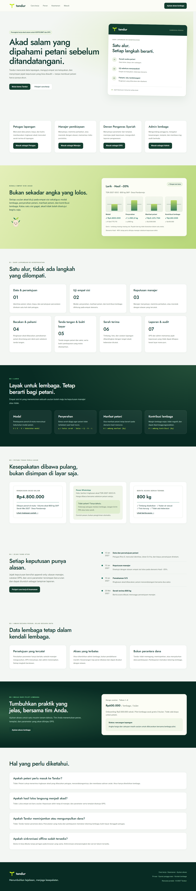
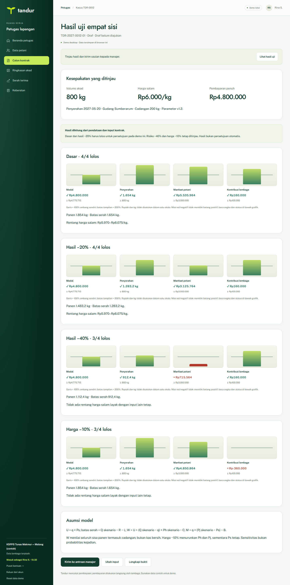
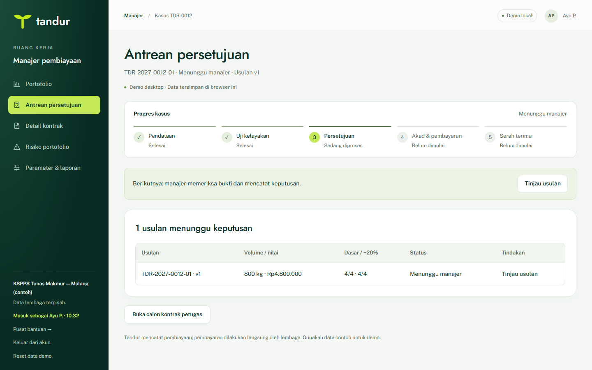
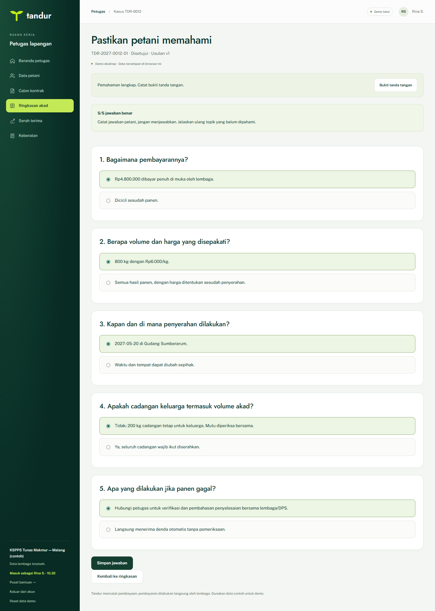
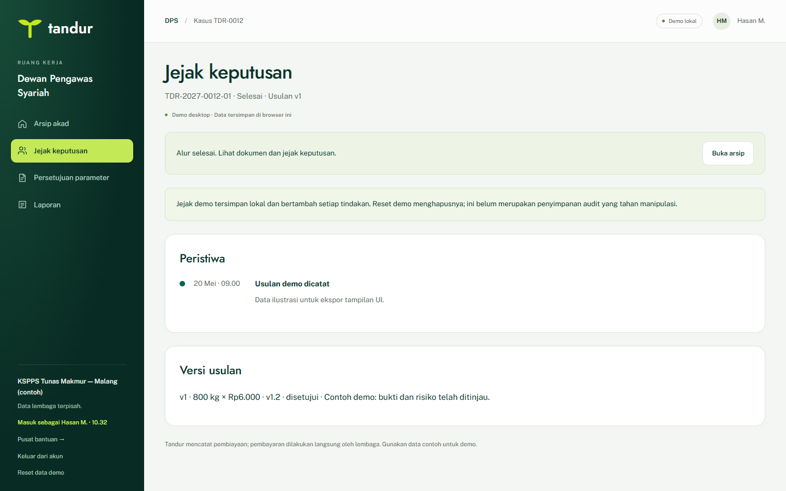

<div align="center">


# Tandur

**Perangkat kerja akad salam untuk KSPPS/BMT, dari pendataan petani, uji kelayakan, persetujuan, sampai serah terima panen.**

[**Demo langsung**](https://tandur-psi.vercel.app/) · [Alur demo](prototipe/README.md#demo-dari-awal-sampai-akhir) · [Perhitungan](prototipe/README.md#perhitungan) · [Dokumentasi teknis](prototipe/README.md)



</div>

---

## Tentang

Akad **salam** adalah pembiayaan syariah berupa pembayaran di muka atas hasil panen yang diserahkan kemudian. Dalam praktik, prosesnya sering tercatat di kertas dan sulit diaudit. **Tandur** adalah prototipe web yang memandu seluruh siklus akad dalam satu alur kerja yang dapat ditelusuri: setiap angka, bukti, dan keputusan tercatat dan terhubung ke kasus yang sama.

> Prototipe untuk keperluan demonstrasi. Data bersifat ilustratif; tidak ada backend, autentikasi sungguhan, maupun perpindahan uang.

## Fitur utama

| Peran | Yang dapat dilakukan |
|---|---|
| **Petugas lapangan** | Pendataan petani dan lahan, rincian biaya, cadangan dan bukti, uji kelayakan calon kontrak, ringkasan akad, uji pemahaman petani, tanda tangan, serah terima |
| **Manajer** | Antrean persetujuan dengan tinjauan bukti, setujui / minta perbaikan / tolak dengan alasan, finalisasi serah terima, pemantauan risiko portofolio |
| **Dewan Pengawas Syariah** | Arsip, jejak keputusan, persetujuan parameter, laporan |
| **Admin** | Kelola akun dan menerapkan versi parameter yang disetujui |

- **Uji ketahanan otomatis:** setiap calon kontrak diuji pada skenario dasar, panen −20%, panen −40%, dan harga −10% sebelum boleh diajukan.
- **Uji pemahaman petani:** tanda tangan terkunci sampai petani menjawab lima pertanyaan inti dengan benar.
- **Kontrol serah terima:** finalisasi diblokir bila selisih berat > ±1%, kadar air > 25%, kotoran > 3%, atau keberatan belum diselesaikan.
- **Versi parameter:** ambang diusulkan manajer, disetujui DPS, diterapkan admin; akad berjalan tidak ikut berubah.
- **Dokumen siap cetak:** ringkasan akad dan berita acara dihasilkan dari data kasus yang sama.

## Tangkapan layar

| Uji kelayakan calon kontrak | Antrean persetujuan manajer |
|---|---|
|  |  |
| **Uji pemahaman petani** | **Jejak keputusan DPS** |
|  |  |

Galeri lengkap berisi seluruh layar desktop ada di folder [`hasil-ui/`](hasil-ui/).

## Menjalankan

Tanpa build dan tanpa dependensi. Buka [demo langsung](https://tandur-psi.vercel.app/), atau secara lokal:

```bash
git clone https://github.com/Yance30/Tandur.git
# buka prototipe/index.html di browser desktop
```

Pilih **Mulai demo Tandur** di beranda untuk panduan langkah demi langkah. Detail alur, rumus, penyimpanan, dan pengujian ada di [dokumentasi teknis](prototipe/README.md).

## Teknologi

HTML · CSS · JavaScript (vanilla, tanpa framework) · `localStorage` · Playwright untuk pengujian · Vercel
